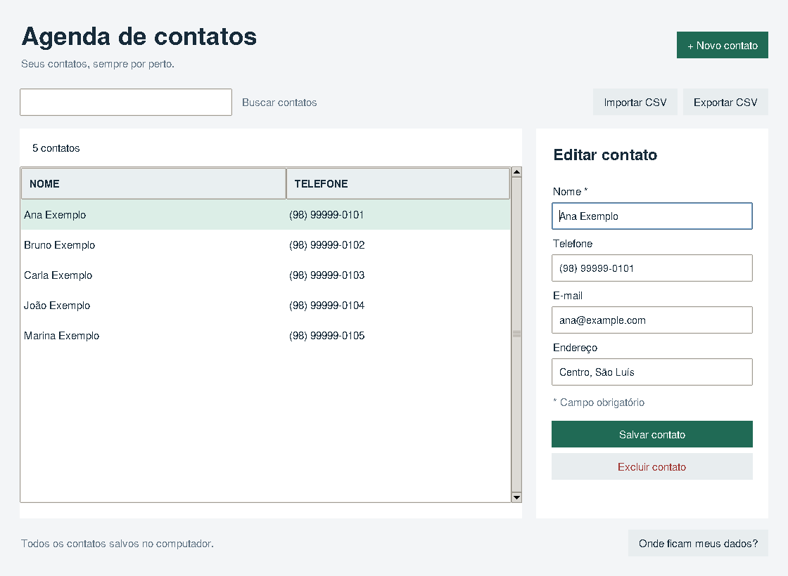

# Agenda de Contatos

Uma agenda para usar no computador: cadastre nomes, telefones, e-mails e endereços em uma janela só. Os dados ficam salvos localmente e o programa funciona sem internet.



## Instalar no Windows

1. Baixe **AgendaContatos-Windows.zip** na [página de versões](https://github.com/brunnomoreirabr-sketch/agenda-contatos/releases/latest).
2. Extraia o ZIP inteiro.
3. Abra **Instalar no Windows.bat**.
4. Use o atalho **Agenda de Contatos** na área de trabalho.

O pacote inclui o executável e dispensa Python. A instalação é feita para o usuário atual, sem precisar de administrador. O executável não tem assinatura digital, então o Windows pode pedir confirmação na primeira execução.

## O que dá para fazer

- Cadastrar, consultar, editar e excluir contatos.
- Buscar por nome, telefone, e-mail ou endereço, com ou sem acentos.
- Importar CSV e ignorar contatos com os quatro campos idênticos.
- Exportar todos os contatos salvos para uma cópia de segurança em CSV.

O nome é obrigatório. Telefone, e-mail e endereço são opcionais. Cada clique em **Salvar contato** grava a alteração no computador; fechar a janela avisa se ainda houver alterações no formulário.

Atalhos: `Ctrl+N` cria um contato, `Ctrl+F` abre a busca e `Ctrl+S` salva.

## Executar pelo código

Requer Python 3.10 ou superior com Tkinter. Não há dependências Python adicionais.

```bash
git clone https://github.com/brunnomoreirabr-sketch/agenda-contatos.git
cd agenda-contatos
python agenda.py
```

No Linux e no macOS, use `python3` se necessário. Em distribuições Debian/Ubuntu, o Tkinter pode ser instalado com `sudo apt install python3-tk`.

Para criar um atalho no Linux ou um lançador na área de trabalho do macOS:

```bash
python3 instalar_desktop.py
```

No Windows, a instalação pelo código usa **Instalar no Windows.bat** e requer Python com Tkinter instalado. No macOS, mantenha a instalação do Python usada para criar o lançador.

## Dados e cópias de segurança

Os contatos usam SQLite, incluído no Python, e ficam separados da pasta do programa:

| Sistema | Arquivo |
| --- | --- |
| Windows | `%LOCALAPPDATA%\AgendaContatos\contatos.sqlite3` |
| Linux | `~/.local/share/agenda-contatos/contatos.sqlite3` |
| macOS | `~/Library/Application Support/AgendaContatos/contatos.sqlite3` |

No Linux, `XDG_DATA_HOME` é respeitado quando configurado. O botão **Onde ficam meus dados?** mostra o caminho exato. Os dados não são enviados ao GitHub nem a outros serviços.

Use **Exportar CSV** para manter uma cópia de segurança. A exportação inclui todos os contatos salvos, mesmo quando a busca está filtrada. Para importar uma agenda existente, use UTF-8 e as colunas abaixo, separadas por vírgula, ponto e vírgula ou tabulação. Cabeçalhos `e-mail` e `endereço` também são aceitos.

```csv
nome,telefone,email,endereco
Ana Exemplo,(98) 99999-0101,ana@example.com,Centro
```

A importação acrescenta contatos e preserva os existentes. Se uma linha tiver dados inválidos, o arquivo inteiro é recusado antes de gravar qualquer contato. Nomes repetidos são permitidos; apenas registros inteiramente idênticos são ignorados na importação.

Para remover o programa, apague o atalho e a pasta da aplicação. Os contatos ficam na pasta de dados acima e só são removidos se você apagar essa pasta também.

## Decisões do projeto

- **Tkinter:** permite criar a interface com a biblioteca padrão do Python.
- **SQLite:** mantém os dados separados da instalação, identifica cada contato por um ID e permite contatos com nomes iguais.
- **CSV para intercâmbio:** a importação valida todas as linhas antes de gravar, e a exportação permite levar os contatos para outros programas.

Os testes cobrem persistência após reabrir o banco, busca sem acentos, edição e exclusão, contatos com o mesmo nome, importação/exportação, duplicatas e recusa de arquivos inválidos. A automação Windows também instala o programa e confere se o atalho abre o executável e cria o banco local.

A versão atual foi feita para uso individual no computador e não oferece sincronização entre dispositivos.

## Organização

```text
agenda.py                    Abre a aplicação
agenda/ui.py                 Janela e ações do usuário
agenda/storage.py            Cadastro, busca, SQLite e CSV
instalar_windows.ps1         Instalação e atalho no Windows
instalar_desktop.py          Atalhos no Linux e macOS
tests/test_storage.py        Testes de persistência e CSV
```

Para verificar o armazenamento:

```bash
python -m unittest discover -s tests -v
```

A automação do GitHub executa os testes a cada alteração. Tags `v*` também geram o pacote Windows, verificam sua inicialização e publicam o ZIP em Releases.

## Referência

A ideia de funcionalidades veio do material enviado sobre [Agenda Simples em Python, de vrsmarcos26](https://github.com/vrsmarcos26/Agenda-Simples-em-Python). Esta versão tem implementação própria, interface gráfica e armazenamento local em SQLite com importação/exportação de CSV. A imagem acima usa somente contatos fictícios.
